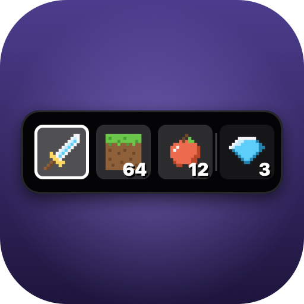

# ToucHorizon

A native mod for [Horizon](https://playhorizon.dev), the Rust rewrite of Minecraft: Java
Edition, that puts your **hotbar and inventory on the Touch Bar** of a MacBook Pro.


- **Tap a hotbar item** to select it, as its number key does.
- **Tap an inventory item** to swap it into the selected hotbar slot, as pressing the slot's
  number key over it in the inventory screen does. Tapping an empty inventory cell moves the
  selected item there.
- **Swipe** the strip to scroll through all 27 inventory slots.
- **⇄** swaps the selected slot with the off hand (F).
- The selected slot has an outline and a brighter tile. Icons are the game's own item textures,
  with stack counts.

It works in single player and on servers. A swap is the same inventory click the game sends when
you press a number key in the inventory, so servers see an ordinary click. Taps are ignored while
a stack is on the cursor, and while a screen other than the inventory or a container is open.

**Settings** are in Options › Mods › ToucHorizon: *Touch Bar shows* (Hotbar + inventory / Hotbar
only) and *Off-hand button* (on/off).

## Install

In the Horizon launcher, go to **Mods** › **Add from GitHub** and paste
`https://github.com/szg1/ToucHorizon`. Then build the instance (**I trust these mods: build**).
From the command line:

```bash
horizon-launcher mods add-github https://github.com/szg1/ToucHorizon --trust-native-code
```

It's for macOS only: the build leaves it out elsewhere. The launcher finds the bundle in [`touchorizon/`](touchorizon), packs it into a `.hnmod` and
builds it into your game. Native mods are compiled into the game and run unsandboxed, so read the
source first. It's short.

If nothing shows up, check that **System Settings › Keyboard › Touch Bar settings › Touch Bar
shows** is set to *App Controls*. Holding **fn** shows the F-keys instead.

## Version

Pinned to Horizon **nightly-2026-11-08-fdc87ae** (`horizon_revision` in
[`horizon-mixin.toml`](touchorizon/horizon-mixin.toml)). The mod reads the inventory and sends
inventory clicks through the game's own code, which isn't one of Horizon's stable hook points.
So a newer Nightly may need the pin moved, plus a small fix if those internals changed. The
launcher's **Build anyway** often works anyway.

## How it works

| File | What it does |
| --- | --- |
| [`horizon-mixin.toml`](touchorizon/horizon-mixin.toml) | The bundle: one module, one crate, four hooks (`frame`, `mods`, `settings`, `settings_click`). |
| [`runtime.rs`](touchorizon/runtime.rs) | A module of the game's `game.rs`. Each frame it applies taps (select, or a `SWAP` click on the inventory menu) and passes the 36 slots to the Touch Bar. It also holds the settings. |
| [`frame.rs`](touchorizon/frame.rs), [`list.rs`](touchorizon/list.rs), [`settings.rs`](touchorizon/settings.rs), [`click.rs`](touchorizon/click.rs) | Hook helpers. |
| [`appkit/`](touchorizon/appkit) | The `touchorizon-appkit` crate. It sets an `NSTouchBar` on the game window: an `NSScrubber` of item cells plus a button, built with raw `objc2` messages (only crates already in Horizon's `Cargo.lock`). Icons come from the prepared resources (`assets/*/models/item/*.json` → texture). |

### Try the Touch Bar without the game

```bash
cd touchorizon/appkit
cargo run --example demo -- /path/to/resources --run
```

`/path/to/resources` is any folder holding `assets/minecraft/…`, for example the 26.3 client jar
unzipped. Leave out `--run` to probe it headless instead: it lists the cells, simulates taps and
writes cell PNGs to the temp folder.

```bash
cargo test
```

## License

MIT. Not affiliated with Mojang, Microsoft or the Horizon project.
